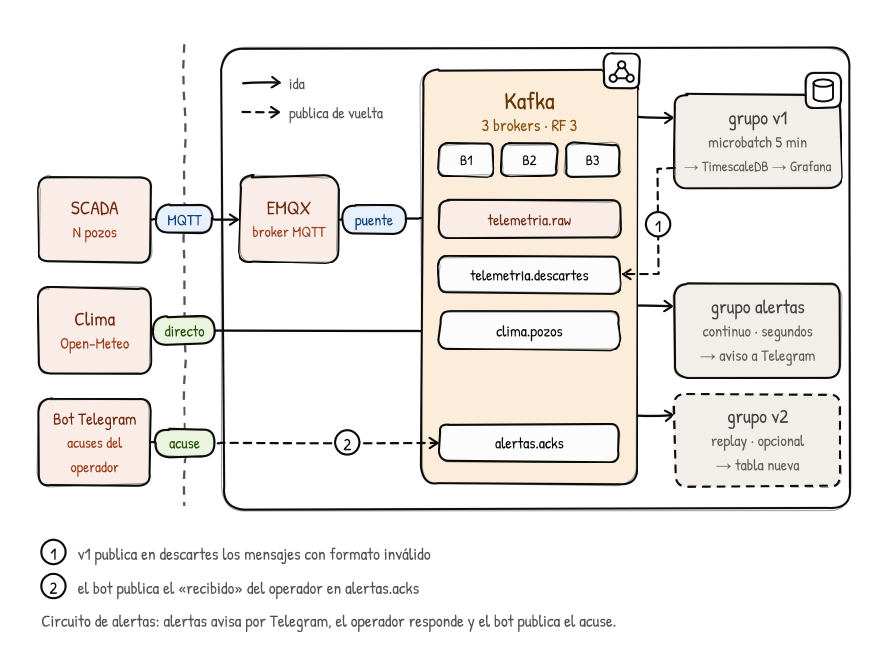

# iiot-telemetry-pipeline

**Log distribuido y replicado con Apache Kafka.** Caso de aplicación: telemetría de pozos (SCADA) por Modbus y MQTT.

Un simulador de PLC genera presión, temperatura y caudal de N pozos. Un gateway los lee por Modbus TCP y los publica en un broker MQTT (EMQX), que los reenvía a un clúster de Kafka de 3 brokers. Dos grupos de consumidores independientes leen ese log: uno guarda los datos en TimescaleDB (graficados en Grafana) y otro genera alertas.

## Contenido

1. [Arquitectura y componentes](#arquitectura-y-componentes)
2. [Requisitos](#requisitos)
3. [Puesta en marcha](#puesta-en-marcha)
4. [Cada componente en detalle](#cada-componente-en-detalle)
5. [Scripts de operación](#scripts-de-operación)
6. [Demos](#demos)
7. [Apagar y reiniciar desde cero](#apagar-y-reiniciar-desde-cero)
8. [Kafka en una VM](#kafka-en-una-vm-opcional)
9. [Problemas frecuentes](#problemas-frecuentes)
10. [Limitaciones y pendientes](#limitaciones-y-pendientes)

## Arquitectura y componentes



El diagrama muestra el diseño completo. En la implementación actual:

- El bloque **SCADA** son dos programas: un PLC simulado ([gateway/server.py](gateway/server.py)) y un gateway que lo lee por Modbus TCP y publica por MQTT ([gateway/gateway.py](gateway/gateway.py)).
- El grupo **`v1`** escribe lotes cada **60 s** (el diagrama indica 5 min).
- **Todavía no están implementados** el productor de clima, el bot de acuses ni la publicación en `telemetria.descartes`. El aviso por Telegram desde `alertas` sí está, y es opcional.

El sistema tiene dos partes que **se levantan por separado**:

- **Infraestructura**, con Docker Compose.
- **Programas en Python** (simulador, gateway y consumidores), que **no están dockerizados** y se ejecutan en el host con `uv run`. `docker compose up` no los inicia.

| Componente | Cómo corre | Archivo | Puerto en el host |
|---|---|---|---|
| Kafka, 3 brokers (`kafka-1` a `kafka-3`) | Docker | [docker-compose.kafka.yml](docker-compose.kafka.yml) | 29092, 29093, 29094 |
| `kafka-init` (crea los topics y termina) | Docker | [docker-compose.kafka.yml](docker-compose.kafka.yml) | |
| Kafka UI | Docker | [docker-compose.kafka.yml](docker-compose.kafka.yml) | http://localhost:8090 |
| EMQX (broker MQTT y puente a Kafka) | Docker | [docker-compose.yml](docker-compose.yml) | 1883 (MQTT), http://localhost:18083 |
| TimescaleDB | Docker | [docker-compose.yml](docker-compose.yml) | 5432 |
| Grafana | Docker | [docker-compose.yml](docker-compose.yml) | http://localhost:3000 |
| Simulador de PLC (servidor Modbus) | `uv run` | [gateway/server.py](gateway/server.py) | 5020 |
| Gateway Modbus a MQTT | `uv run` | [gateway/gateway.py](gateway/gateway.py) | |
| Consumidor `v1` (y `v2`) | `uv run` | [consumidores/consumidor-timescale.py](consumidores/consumidor-timescale.py) | |
| Consumidor `alertas` | `uv run` | [consumidores/alertas.py](consumidores/alertas.py) | |

El resto de los archivos `.py` son módulos que usan estos programas: no se ejecutan solos.

## Requisitos

- **Docker** con **Docker Compose v2** (en Windows y Mac, Docker Desktop abierto).
- **[uv](https://docs.astral.sh/uv/)** para los programas en Python. El proyecto pide Python 3.14 o superior; uv lo descarga si no está instalado.
- **Git**.
- Una terminal **bash**. En Windows, usar **Git Bash** (los comandos de este README y los scripts de `scripts/` están escritos para bash).
- Puertos libres: 1883, 3000, 5020, 5432, 8083, 8090, 18083, 29092, 29093 y 29094.
- Memoria: los límites de los contenedores suman unos 3 GB, sin contar EMQX. Con poca RAM, ver cómo [levantar solo lo necesario](#2-levantar-kafka).

Todos los comandos se ejecutan **desde la raíz del repo**.

## Puesta en marcha

### 1. Preparar el entorno (una sola vez)

```bash
git clone https://github.com/Baumann71/iiot-telemetry-pipeline.git
cd iiot-telemetry-pipeline
cp .env.example .env
uv sync
```

Editar `.env`: completar las dos versiones, que vienen vacías (sin ellas Docker Compose no arranca), y cambiar las dos contraseñas de ejemplo.

```ini
KAFKA_VERSION=4.4.0
TIMESCALE_VERSION=2.31.2-pg16
POSTGRES_PASSWORD=una_clave_propia
GRAFANA_ADMIN_PASSWORD=otra_clave_propia
```

El resto puede quedar como viene en [.env.example](.env.example). El archivo `.env` no se versiona.

### 2. Levantar Kafka

```bash
docker compose -f docker-compose.kafka.yml up -d
docker compose -f docker-compose.kafka.yml logs -f kafka-init
```

La primera vez descarga las imágenes. El segundo comando termina solo cuando `kafka-init` muestra `Topics creados:` y la lista, que debe incluir `telemetria.raw`.

Con poca memoria, se puede omitir Kafka UI:

```bash
docker compose -f docker-compose.kafka.yml up -d kafka-1 kafka-2 kafka-3 kafka-init
```

### 3. Levantar EMQX, TimescaleDB y Grafana

```bash
docker compose up -d
docker compose ps
```

`emqx_proy1` y `timescaledb` deben quedar en estado `healthy`. Las tablas, el puente a Kafka, el datasource y el dashboard se cargan solos.

### 4. Ejecutar los programas en Python

Cada programa ocupa su terminal. Abrirlos **en este orden** y dejarlos corriendo:

```bash
# Terminal 1: simulador de PLC (tiene que estar antes que el gateway)
uv run gateway/server.py

# Terminal 2: gateway Modbus -> MQTT
uv run gateway/gateway.py

# Terminal 3: consumidor v1 (Kafka -> TimescaleDB)
uv run consumidores/consumidor-timescale.py

# Terminal 4: consumidor de alertas
uv run consumidores/alertas.py
```

Cada uno se detiene con `Ctrl+C`.

### 5. Comprobar que funciona

| Qué mirar | Salida esperada |
|---|---|
| Terminal del gateway | Una línea de lectura por pozo cada 5 s y `Mensaje confirmado mid=...` |
| Kafka UI (http://localhost:8090), topic `telemetria.raw` | Mensajes nuevos, con key `pozo-01` a `pozo-06` |
| Terminal de `v1` | Después de 60 s: `lote: N filas (M malas), commit hecho` |
| `bash scripts/sql.sh "SELECT count(*) FROM lecturas_v1;"` | Un número que crece de a un lote |
| `bash scripts/grupos.sh` | Los grupos `v1` y `alertas` con sus offsets y lag |
| Grafana (http://localhost:3000), dashboard **Telemetria** | Curvas de presión, temperatura y caudal por pozo |

Accesos:

- **Grafana:** usuario `admin`, contraseña `GRAFANA_ADMIN_PASSWORD` del `.env`.
- **EMQX** (http://localhost:18083): en un volumen nuevo, usuario `admin` y contraseña `public`; pide cambiarla al entrar.

## Cada componente en detalle

### Variables de entorno de los programas Python

- Los **consumidores** leen el `.env`. Una variable definida en la terminal tiene prioridad sobre la del archivo.
- El **simulador** y el **gateway** **no leen el `.env`**: solo toman variables de la terminal.

Se definen delante del comando:

```bash
N_POZOS=3 uv run gateway/server.py
```

### Simulador de PLC

[gateway/server.py](gateway/server.py) es un servidor Modbus TCP (pymodbus) en `127.0.0.1:5020`. Cada pozo es un dispositivo con su unit id (1 a N) y valores base propios, que se actualizan cada segundo.

```bash
uv run gateway/server.py
EVENTOS_POR_HORA=60 uv run gateway/server.py    # con anomalías: ~1 por minuto en toda la planta
```

| Variable | Por defecto | Qué hace |
|---|---|---|
| `N_POZOS` | `6` | Cantidad de pozos simulados |
| `EVENTOS_POR_HORA` | `0` | Anomalías esporádicas (sobrepresión, sobrecalentamiento, bomba detenida) |

Para probar solo la lectura Modbus, sin MQTT: `uv run gateway/async_client.py` (lee el pozo 1 cada segundo).

### Gateway Modbus a MQTT

[gateway/gateway.py](gateway/gateway.py) consulta todos los pozos con asyncio, arma un JSON por sensor (con timestamp en UTC y un contador `seq`) y lo publica con QoS 1 en `scada/<pozo_id>/<sensor>`.

```bash
uv run gateway/gateway.py
uv run gateway/gateway.py --broker_ip 192.168.0.10 --broker_port 1883   # los dos argumentos van juntos
```

| Variable | Por defecto | Qué hace |
|---|---|---|
| `N_POZOS` | `6` | Debe coincidir con el del simulador |
| `INTERVALO_S` | `5` | Segundos entre lecturas |
| `MODBUS_HOST`, `MODBUS_PORT` | `127.0.0.1`, `5020` | Dirección del simulador |
| `BROKER_IP`, `BROKER_PORT` | `127.0.0.1`, `1883` | Dirección de EMQX |
| `MAX_COLA` | `1000` | Mensajes pendientes que guarda paho sin conexión (con 6 pozos, unos 4,5 min) |

La publicación está encapsulada en una clase propia ([gateway/publisher.py](gateway/publisher.py)) que corre el cliente MQTT en un hilo aparte, no bloquea la lectura del PLC, registra las confirmaciones del broker y maneja los errores de lectura, de serialización y de cola llena.

Ante un corte del broker, los mensajes que entran en la cola de paho se entregan al reconectar; el resto se descarta y queda registrado. La cola vive en memoria, así que se pierde si el proceso se cae. Donde no se puedan perder datos haría falta un buzón persistente (por ejemplo, con SQLite).

### Puente MQTT a Kafka (EMQX)

Una regla de EMQX toma `scada/#`, saca `pozo_id` del topic y una action lo publica en `telemetria.raw` con key `pozo_id` y `acks=all` (`all_isr`). La configuración (connector, action y regla) está versionada en [emqx/base.hocon](emqx/base.hocon) y se monta en el contenedor: en un clon limpio el puente aparece solo. Lo que se cambie desde el dashboard queda en el volumen `emqx_data` y tiene prioridad sobre ese archivo.

Para verificarlo, con el simulador y el gateway corriendo (cortar con `Ctrl+C`):

```bash
# cada pozo tiene que caer siempre en la misma partición
docker exec -it kafka-1 bash -c "KAFKA_HEAP_OPTS=-Xmx64m /opt/kafka/bin/kafka-console-consumer.sh \
  --bootstrap-server kafka-1:9092 --topic telemetria.raw --from-beginning \
  --property print.key=true --property print.partition=true"
```

También se ve en Kafka UI y en las métricas de la regla en el dashboard de EMQX.

La partición la elige EMQX, no Kafka, con `erlang:phash2(key) rem particiones` (no el murmur2 de los clientes de Kafka). Con 6 pozos, `pozo-02` a `pozo-05` caen en la partición 2 y `pozo-01` y `pozo-06` en la 5. Es una colisión del hash, no un error: el orden por pozo se mantiene.

### Kafka y sus topics

Tres nodos en KRaft (cada uno es broker y controller), con factor de replicación 3 y `min.insync.replicas=2`. La creación automática de topics está desactivada: los crea `kafka-init`, con 7 días de retención.

| Topic | Particiones | Uso |
|---|---|---|
| `telemetria.raw` | 6 | Lecturas de los pozos (key `pozo_id`) |
| `telemetria.descartes` | 3 | Reservado para mensajes inválidos (todavía no se publica) |
| `clima.pozos` | 3 | Reservado (extra no implementado) |
| `alertas.acks` | 3 | Reservado (extra no implementado) |

El compose de Kafka está separado del resto para poder llevar los brokers a una VM. Los dos comparten la red de Docker `kafka-net`.

### Consumidor `v1`

[consumidores/consumidor-timescale.py](consumidores/consumidor-timescale.py) lee `telemetria.raw`, valida y califica cada lectura, y cada **60 s** escribe el lote en TimescaleDB.

```bash
uv run consumidores/consumidor-timescale.py
```

| Variable | Por defecto | Qué hace |
|---|---|---|
| `GROUP_ID` | `v1` | Consumer group |
| `TABLA` | `lecturas_v1` | Tabla de destino (ya creada: `lecturas_v1` o `lecturas_v2`) |
| `KAFKA_BOOTSTRAP` | `localhost:29092,localhost:29093,localhost:29094` | Brokers |
| `POSTGRES_HOST`, `POSTGRES_PORT` | `localhost`, `5432` | Dirección de la base |
| `POSTGRES_DB`, `POSTGRES_USER`, `POSTGRES_PASSWORD` | las del `.env` | Credenciales |

- El intervalo del lote está fijo en el código (`LOTE_S = 60`); definir la variable `LOTE_S` no lo cambia.
- **Sin pérdida:** el offset se confirma solo después de escribir el lote en la base.
- **Idempotencia:** la clave primaria es `(pozo_id, ts, sensor)` y la inserción usa `ON CONFLICT DO NOTHING`, así que reprocesar un lote no duplica filas.
- **Inválidos:** [consumidores/validacion.py](consumidores/validacion.py) rechaza los mensajes mal formados o físicamente imposibles; por ahora quedan registrados en la consola (`descartado particion: ... offset: ...`).
- Si la base no está disponible, el programa termina con error y hay que volver a arrancarlo. Retoma desde el último offset confirmado.

### Calidad de lecturas

[consumidores/calidad.py](consumidores/calidad.py) califica cada lectura válida comparándola con la anterior del mismo `(pozo, sensor)`:

| Calidad | Cuándo |
|---|---|
| `mala` | Valor **congelado** (6 lecturas iguales seguidas) o **salto imposible** (más de 40 bar/s, 25 °C/s o 80 m³/día/s) |
| `sospechosa` | Salto grande pero posible, instrumento saturado (pegado al borde de su rango) o lectura duplicada |
| `buena` | El resto |

- Los umbrales de salto están calibrados contra el simulador: un evento real (sobrepresión, etc.) salta como mucho ~17 bar/s, así que queda `sospechosa` y **se sigue avisando**. La calidad no tapa una alarma real.
- **`v1`/`v2`** guardan `calidad` y `calidad_motivo` en la tabla. El estado entre lotes (la lectura anterior de cada sensor) vive en memoria, se reconstruye al arrancar desde la misma tabla y se adopta recién después de escribir el lote y confirmar el offset: si el consumidor muere a mitad de lote, el reproceso califica igual.
- **`alertas`** usa el mismo módulo con su propio estado en memoria (no espera a `v1` ni lee la base). Una lectura `mala` no dispara alertas: queda en la consola como `IGNORADA`.

### Consumidor `alertas`

[consumidores/alertas.py](consumidores/alertas.py) lee `telemetria.raw` en continuo, con su propio consumer group, y avisa en segundos. No usa la base: si TimescaleDB se cae, sigue funcionando.

```bash
uv run consumidores/alertas.py
```

| Variable | Por defecto | Qué hace |
|---|---|---|
| `FALTANTE_S` | `20` | Segundos sin datos de un sensor antes de avisar |
| `KAFKA_BOOTSTRAP` | `localhost:29092,localhost:29093,localhost:29094` | Brokers |
| `TELEGRAM_TOKEN`, `TELEGRAM_CHAT_ID` | vacías | Opcionales: además de imprimir, envía cada aviso a Telegram |

- **Umbrales** (operación normal): presión 10 a 100 bar, temperatura 20 a 100 °C, caudal 30 a 300 m³/día. Avisa solo cuando un sensor cambia de estado (`ALERTA ALTO`/`ALERTA BAJO` al salir del rango, `NORMALIZADO` al volver).
- **Dato faltante:** `SIN DATOS` cuando un sensor deja de reportar y `RECUPERADO` cuando vuelve. Solo vigila los sensores que vio desde que arrancó.
- **Un grupo nuevo empieza por el final** del topic: no avisa por datos anteriores a su primer arranque.
- **Entrega al menos una vez:** el offset se confirma cada 5 s. Si el proceso se cae entre dos commits, al volver puede repetir alguna alerta.
- **Telegram:** el token lo entrega @BotFather. Va en el `.env`, nunca en el repo. Sin esas variables, el programa solo imprime ([consumidores/notificador.py](consumidores/notificador.py)).

### TimescaleDB

El esquema ([db/init/01-schema.sql](db/init/01-schema.sql)) crea las hypertables `lecturas_v1` y `lecturas_v2`. Estos scripts corren **solo cuando el volumen está vacío**.

```bash
bash scripts/sql.sh                                         # psql interactivo
bash scripts/sql.sh "SELECT count(*) FROM lecturas_v1;"     # una consulta
```

### Grafana

Entrar a http://localhost:3000. El datasource ([grafana/provisioning/datasources/timescaledb.yml](grafana/provisioning/datasources/timescaledb.yml)) y el dashboard **Telemetria** ([grafana/dashboard/telemetria.json](grafana/dashboard/telemetria.json)) se cargan solos.

- **Presión, temperatura y caudal:** una línea por pozo. Cada punto es el promedio de las lecturas de un intervalo (mínimo 5 s). No incluye lecturas de calidad `mala`.
- **Último dato recibido por sensor:** antigüedad del último dato de cada sensor en la base. Con `v1` escribiendo cada 60 s, hasta ~60 s es normal; si `v1` se detiene, se pone en rojo.
- **Variable `tabla`:** `lecturas_v1` o `lecturas_v2`, para mirar el resultado del replay.
- Grafana muestra lo que hay en la base, no lo que hay en Kafka: los gráficos avanzan de a un lote aunque el dashboard refresque cada 30 s.

Para cambiar el dashboard: editarlo en la UI, *Export as JSON* (con "Export for sharing externally" apagado) y reemplazar el archivo del repo; Grafana lo relee en 30 s. Desde la UI no se puede guardar porque está provisionado.

## Scripts de operación

Están en [scripts/](scripts/) y se ejecutan con `bash`. Usan `docker exec`, así que se corren en la máquina donde está el contenedor que consultan.

| Comando | Qué muestra o hace |
|---|---|
| `bash scripts/broker.sh estado` | Brokers en ejecución, y líder e ISR de cada partición de `telemetria.raw` |
| `bash scripts/broker.sh caer N` | `docker kill kafka-N`: falla abrupta, sin apagado ordenado (N = 1, 2 o 3) |
| `bash scripts/broker.sh levantar N` | Vuelve a arrancar `kafka-N` |
| `bash scripts/grupos.sh [grupos...]` | Offset y lag de cada grupo sobre `telemetria.raw` (por defecto `v1` y `alertas`) |
| `bash scripts/control.sh [tabla]` | Por partición, filas en la base contra rango de offsets (por defecto `lecturas_v1`) |
| `bash scripts/sql.sh ["consulta"]` | psql contra TimescaleDB |

En `control.sh`, la columna `sin_fila` cuenta offsets que no tienen fila en la base. En `0` significa que no hay huecos en el rango. Un valor mayor no implica pérdida: puede ser un mensaje inválido descartado o un duplicado en Kafka absorbido por el upsert.

## Demos

Todas parten del sistema completo corriendo (pasos 2 a 4) desde hace unos minutos.

### Un broker caído

```bash
bash scripts/broker.sh estado       # antes: ISR con 3 réplicas
bash scripts/broker.sh caer 2
bash scripts/broker.sh estado       # ISR con 2 réplicas y líderes reasignados
```

Qué observar: el gateway, `v1`, `alertas` y Grafana siguen funcionando. Quedan 2 de 3 controllers (hay quórum) y 2 réplicas en el ISR, que alcanza para `min.insync.replicas=2`.

```bash
bash scripts/broker.sh levantar 2
bash scripts/broker.sh estado       # kafka-2 vuelve al ISR
bash scripts/control.sh             # después del siguiente lote de v1
```

El liderazgo no vuelve de inmediato al broker recuperado. Para forzar el rebalanceo:

```bash
docker exec kafka-1 bash -c "KAFKA_HEAP_OPTS=-Xmx64m /opt/kafka/bin/kafka-leader-election.sh \
  --bootstrap-server kafka-1:9092 --election-type preferred --all-topic-partitions"
```

### Dos brokers caídos

```bash
bash scripts/broker.sh caer 2
bash scripts/broker.sh caer 3
```

Qué observar: las escrituras en Kafka se detienen. Con 1 de 3 nodos no hay quórum de controllers (KRaft usa Raft y necesita mayoría) ni se cumple `min.insync.replicas=2`. Kafka prioriza la **consistencia sobre la disponibilidad**: no confirma escrituras que quedarían en una sola copia.

- El gateway sigue publicando, porque EMQX le confirma sin esperar a Kafka.
- En el dashboard de EMQX, action `kafka_local`, crece el contador de mensajes en cola (`queuing`).
- Grafana deja de recibir datos nuevos.
- Sin quórum, `broker.sh estado` puede no mostrar el detalle de las particiones.
- Si `v1` termina con error, volver a arrancarlo: reprocesa sin duplicar.

**No reiniciar EMQX mientras tanto:** los mensajes pendientes están en memoria.

```bash
bash scripts/broker.sh levantar 2
bash scripts/broker.sh levantar 3
```

`queuing` vuelve a 0, `v1` escribe lo acumulado y Grafana completa el hueco. Verificar con `bash scripts/control.sh`.

### Consumidor muerto a mitad de lote

1. Con `v1` corriendo, esperar a ver un `commit hecho` y, unos 30 s después, **cerrar su terminal** sin `Ctrl+C` (en VS Code, el ícono de la papelera).
2. `bash scripts/grupos.sh v1`: el lag crece y el offset confirmado no se mueve.
3. Volver a arrancar `uv run consumidores/consumidor-timescale.py`. Tras una muerte abrupta, Kafka puede tardar unos 45 s en reasignarle las particiones, y luego pasan 60 s hasta el primer lote.
4. `bash scripts/control.sh`: reprocesó desde el último offset confirmado, sin huecos. La clave primaria impide los duplicados.

### Desacople: base de datos caída

```bash
docker compose stop timescaledb
```

En el siguiente lote, `v1` termina con error sin confirmar el offset. El gateway, EMQX, Kafka y `alertas` siguen funcionando.

```bash
bash scripts/grupos.sh              # el lag de v1 crece; alertas sigue al día
docker compose start timescaledb
uv run consumidores/consumidor-timescale.py
```

`v1` retoma desde su último offset confirmado y se pone al día.

### Replay con el grupo `v2`

El mismo programa, con otro grupo y otra tabla, lee todo lo que Kafka conserva desde el offset 0:

```bash
GROUP_ID=v2 TABLA=lecturas_v2 uv run consumidores/consumidor-timescale.py
```

- Progreso: `bash scripts/grupos.sh v1 v2`.
- En Grafana, elegir `lecturas_v2` en la variable `tabla`.
- Comparación entre tablas (las filas del último minuto pueden diferir porque cada grupo escribe en su momento):

```bash
bash scripts/sql.sh "SELECT count(*) FILTER (WHERE a.ts IS NULL) AS solo_v2,
       count(*) FILTER (WHERE b.ts IS NULL) AS solo_v1,
       count(*) FILTER (WHERE a.valor <> b.valor) AS valor_distinto
FROM lecturas_v1 a FULL OUTER JOIN lecturas_v2 b USING (pozo_id, ts, sensor);"
```

Para repetir el replay desde cero, detener `v2` y borrar su grupo y sus filas:

```bash
docker exec kafka-1 bash -c "KAFKA_HEAP_OPTS=-Xmx64m /opt/kafka/bin/kafka-consumer-groups.sh \
  --bootstrap-server kafka-1:9092 --delete --group v2"
bash scripts/sql.sh "TRUNCATE lecturas_v2;"
```

### Alertas

Con anomalías automáticas, arrancar el simulador con `EVENTOS_POR_HORA=60`. Deteniendo el gateway, a los 20 s aparece `SIN DATOS` para cada sensor, y `RECUPERADO` al volver a arrancarlo.

Para disparar una alerta puntual, con `alertas` ya corriendo (usa un pozo que el gateway no publica):

```bash
uv run python -c "import json,datetime as d,paho.mqtt.publish as p; p.single('scada/pozo-98/presion', json.dumps({'pozo_id':'pozo-98','sensor':'presion','valor':130.0,'ts':d.datetime.now(d.timezone.utc).isoformat()}), qos=1, hostname='localhost')"
```

Aparece `ALERTA ALTO` y, 20 s después, `SIN DATOS` (el pozo dejó de reportar). La alerta se emite solo al cambiar de estado: para repetirla, usar otro número de pozo o reiniciar `alertas`.

### Calidad de lecturas

Con `v1` y `alertas` corriendo:

```bash
# pico: 40 -> 149 -> 41 con 1 s entre lecturas. 149 queda mala y alertas NO avisa "ALERTA ALTO"
uv run python -c "import json,time,datetime as d,paho.mqtt.publish as p
for v in (40,149,41): p.single('scada/pozo-99/presion', json.dumps({'pozo_id':'pozo-99','sensor':'presion','valor':v,'ts':d.datetime.now(d.timezone.utc).isoformat()}), qos=1, hostname='localhost'); time.sleep(1)"

# congelado: 7 veces el mismo valor. Desde la 6.ª lectura queda mala
uv run python -c "import json,time,datetime as d,paho.mqtt.publish as p
for _ in range(7): p.single('scada/pozo-99/temperatura', json.dumps({'pozo_id':'pozo-99','sensor':'temperatura','valor':55.5,'ts':d.datetime.now(d.timezone.utc).isoformat()}), qos=1, hostname='localhost'); time.sleep(1)"

# después del próximo lote de v1:
bash scripts/sql.sh "SELECT ts, sensor, valor, calidad, calidad_motivo FROM lecturas_v1 WHERE pozo_id = 'pozo-99' ORDER BY ts;"
```

### Mensaje inválido

Una presión de 10000 bar es físicamente imposible. `v1` la registra como `descartado` y no la guarda:

```bash
uv run python -c "import json,datetime as d,paho.mqtt.publish as p; p.single('scada/pozo-99/presion', json.dumps({'pozo_id':'pozo-99','sensor':'presion','valor':10000,'ts':d.datetime.now(d.timezone.utc).isoformat()}), qos=1, hostname='localhost')"
```

## Apagar y reiniciar desde cero

Primero detener los programas en Python con `Ctrl+C`.

```bash
# apagar conservando los datos
docker compose down
docker compose -f docker-compose.kafka.yml down

# borrar TODOS los datos (topics, offsets, base, configuración de EMQX y Grafana)
docker compose down -v
docker compose -f docker-compose.kafka.yml down -v
```

Después de `down -v`, repetir desde el [paso 2](#2-levantar-kafka).

## Kafka en una VM (opcional)

No hace falta para ejecutar el proyecto: todo corre en una sola máquina. Esta variante separa los brokers en una VM, conectada por una red privada (Tailscale).

**En la VM**, con el repo clonado y el `.env`:

```ini
KAFKA_VERSION=4.4.0
KAFKA_EXTERNAL_HOST=<IP_TAILSCALE_VM>
KAFKA_BIND_IP=<IP_TAILSCALE_VM>
```

```bash
docker compose -f docker-compose.kafka.yml up -d kafka-1 kafka-2 kafka-3 kafka-init
```

El listener no tiene TLS ni autenticación, así que `KAFKA_BIND_IP` evita publicarlo en la interfaz pública. Kafka UI (puerto 8090) no respeta esa variable: por eso el comando no la levanta.

**En la máquina local**, agregar al `.env`:

```ini
KAFKA_BOOTSTRAP_HOSTS=<IP_TAILSCALE_VM>:29092,<IP_TAILSCALE_VM>:29093,<IP_TAILSCALE_VM>:29094
KAFKA_BOOTSTRAP=<IP_TAILSCALE_VM>:29092,<IP_TAILSCALE_VM>:29093,<IP_TAILSCALE_VM>:29094
```

`KAFKA_BOOTSTRAP_HOSTS` lo usa EMQX y `KAFKA_BOOTSTRAP` los consumidores. Luego, `docker compose up -d` (sin levantar el compose de Kafka) y los programas en Python como siempre.

`broker.sh` y `grupos.sh` se ejecutan en la VM; `control.sh` y `sql.sh`, en la máquina local. La latencia medida en esta variante incluye el salto de red hasta la VM.

## Problemas frecuentes

| Síntoma | Causa y solución |
|---|---|
| Compose falla con `definir ... en el .env` | Falta completar una variable del [paso 1](#1-preparar-el-entorno-una-sola-vez) |
| El gateway muestra `No se pudo conectar con el PLC` y termina | Arrancar antes el simulador |
| El gateway termina con error al conectar al broker | EMQX no está levantado: `docker compose up -d` |
| No llegan mensajes a `telemetria.raw` | Comprobar que `kafka-init` creó los topics y, en el dashboard de EMQX, que el connector de Kafka esté conectado |
| `v1` no muestra nada | El primer lote tarda 60 s. Si se mató antes de golpe, sumar unos 45 s |
| `v1` falla por autenticación tras cambiar la contraseña | El volumen conserva la anterior: restaurarla o [reiniciar desde cero](#apagar-y-reiniciar-desde-cero) |
| No existen las tablas | El volumen de la base se creó sin el esquema: [reiniciar desde cero](#apagar-y-reiniciar-desde-cero) |
| `port is already allocated` | Otro programa usa ese puerto (por ejemplo, un PostgreSQL local en el 5432) |
## Limitaciones y pendientes

- Con 6 pozos × 3 sensores cada 5 s (~4 mensajes/s), el volumen no justifica Kafka. Lo justifican los consumidores independientes, el replay y la tolerancia a fallas.
- Tres brokers en una misma máquina o VM son una demostración de arquitectura: no toleran la caída del host.
- El productor de EMQX no es idempotente: en un failover puede duplicar mensajes en `telemetria.raw`. El upsert de `v1` los absorbe.
- El buffer de EMQX hacia Kafka está en memoria: se pierde si EMQX se reinicia con Kafka caído, y al llenarse descarta los mensajes más viejos.
- El lote de `v1` está acotado por tiempo, no por tamaño: al ponerse al día (o en un replay) puede acumular muchos mensajes en memoria.
- Los mensajes inválidos todavía no se publican en `telemetria.descartes`.
- `v2` corre hoy con la misma lógica que `v1`.
- El productor de clima, su enriquecimiento y el bot de acuses no están implementados.
